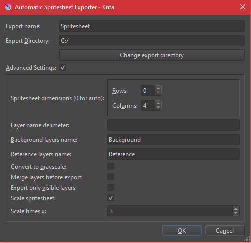

# Krita SpriteSheet Exporter Plugin

Exports layers as spritesheets based on layer names. Multiple different export options for different uses.

## Project Description:

Using Krita's API docs and PyQt5, this plugin adds a new option to the 'Tools' tab in Krita.

* [X] Basic layout based on online sources
* [X] Add normal export - every layer/frame on its own
* [X] Add export as spritesheet - every layer with same name is merged into a single spritesheet
* [X] Add name delimeter textbox, allows to customize naming conventions in the app
* [X] Add convert to grayscale - used to create textures that are colorable with filters
* [X] Add export frame-by-frame - instead of exporting by frame, exports the whole animation as spritesheet
* [X] Add export visible only - exports visible layers only
* [X] Add scale output spritesheet - scales output image by x times

## Installation:

1. Download this code **as a zip file**
2. Open Krita
3. Click on Tools -> Scripts -> Import Python Plugin From File
4. Select the zip file
5. Restart Krita
6. Plugin is now installed! To open the plugin menu, click on Tools -> SpriteSheet Exporter

## Available Options:

* **Export name** - (*Defaults to 'Spritesheet'*) Name of the exported sprites folder ('name'\_sprites), as well as the name of the spritesheet(s) ('name'\_'first layer's name word after splitting'.png)
* **Export directory** - (*Defaults to .kra file directory*) Location, to where the folder and spitesheets will be generated
* **Spritesheet dimensions** - (*Defaults to 0 x 4*) Output spritesheet's dimensions. When both are set to 0 (auto), automatically will try to generate a perfect square from available layers. If there are more images to be exported than 'Rows' x 'Columns', some images will be left out.
* **Layer name delimeter** - (*Defaults to ' ' - spacebar*) This symbol will be used to generate spritesheets. For example, if 4 layers' name starts with 'Body', a spritesheet called 'export name'\_'Body'.png will be created.
* **Background layers name** - (*Defaults to 'Background'*) Layer that starts with this word will be ingored.
* **Referece layers name** - (*Defaults to 'Reference'*) Layer that starts with this word will be ingored.
* **Convert to grayscale** - Before exporting, should the images be converted to grayscale (RGB -> YCbCr, extracts Y-layer). Layers in the projects **are not affected**.
* **Merge layers before export** - Should the layers be merged before exporting. Output is then a single spritesheet with name 'export name'\_'body'.png
* **Export only visible layers** - Should all non-visible layers be skipped. This is useful if the project contains layers that represent multiple states/diffferent objects.
* **Scale spritesheet** - Should the output spritesheet be scaled. Does not scale individual output images.
* **Scale times x** - Scale amount. Final spritesheet dimensions will be multipied by this amount.
